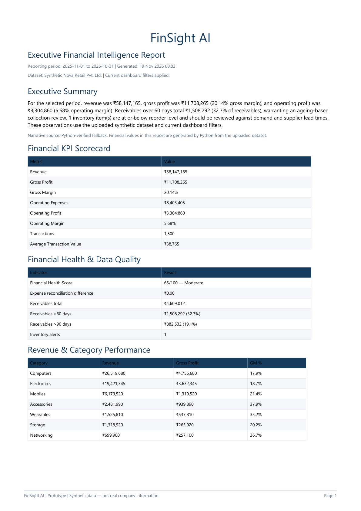
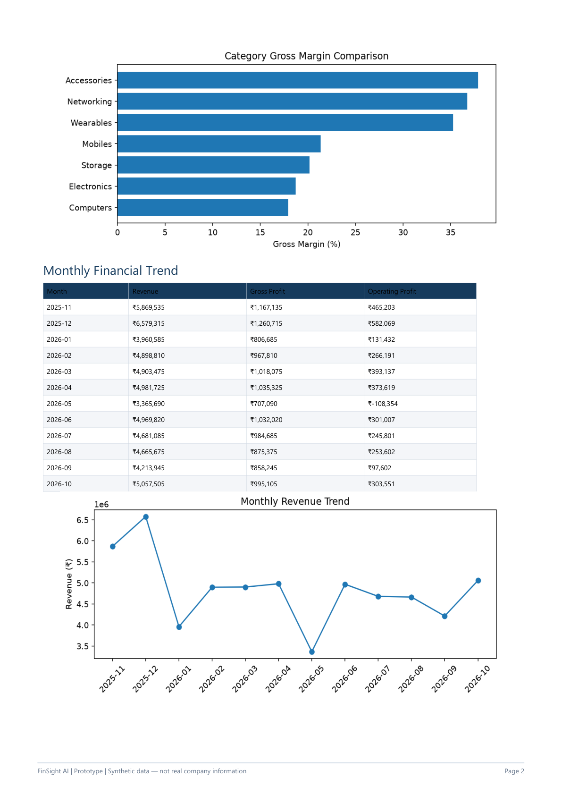
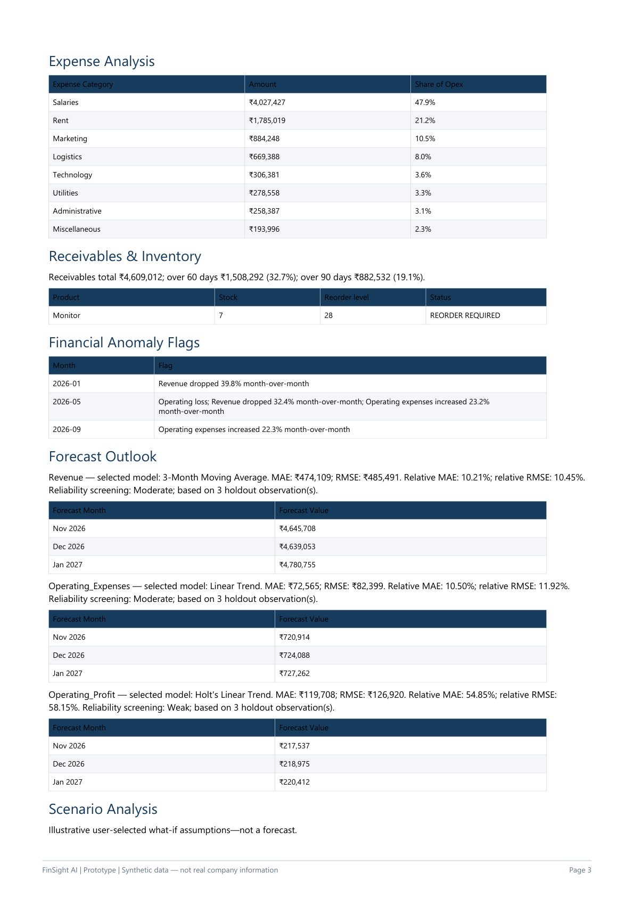
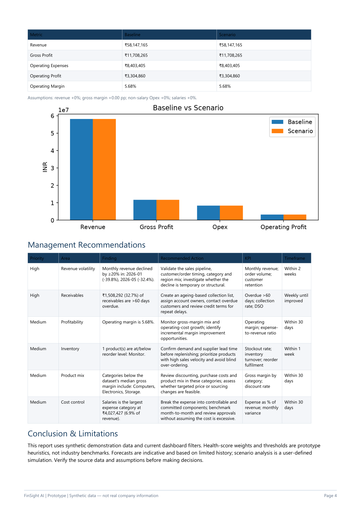

# FinSight AI
### Intelligent Financial Analytics & AI-Powered Decision Support System

**FinSight AI** is a Python-based financial intelligence platform designed to transform raw business data into actionable financial insights through financial analytics, predictive forecasting, anomaly detection, scenario modelling, and Generative AI.

The project combines Finance, Business Analytics, Python, and locally hosted AI to support better business decision-making.

---

## Project Overview

FinSight AI provides an integrated financial analysis environment where users can upload financial data, evaluate business performance, identify potential financial risks, forecast future trends, and generate executive reports.

**Core principle:** Financial calculations are performed programmatically, while AI assists with interpretation and communication.

## Key Features

| Module | Functionality |
|---|---|
| Financial Dashboard | Revenue, gross profit, operating profit and margin analysis |
| Financial Accuracy Audit | Financial reconciliation and data validation |
| Receivables Analysis | Outstanding balances and ageing analysis |
| Anomaly Detection | Identification of unusual financial patterns |
| Predictive Analytics | Revenue, operating expense and operating profit forecasting |
| Forecast Evaluation | MAE and RMSE-based model evaluation |
| Scenario Analysis | Interactive financial What-If simulation |
| AI Financial Analyst | Natural-language financial interpretation |
| Executive Report Generator | Downloadable PDF financial reports |

## Dashboard Showcase

### 1. Executive Financial Report



### 2. Financial Trends & Performance



### 3. Analytics, Anomaly Detection & Forecasting



### 4. Scenario Analysis & Management Recommendations



## Technology Stack

- **Programming:** Python
- **Application Framework:** Streamlit
- **Data Processing:** Pandas, NumPy
- **Visualization:** Plotly, Matplotlib
- **Excel Processing:** OpenPyXL
- **AI Integration:** Ollama
- **Language Model:** Qwen 2.5 3B
- **PDF Reporting:** ReportLab

## Financial & Analytical Methodology

The application incorporates:

- Revenue and profitability analysis
- Gross margin and operating margin calculations
- Expense reconciliation
- Receivables ageing analysis
- Rule-based financial anomaly detection
- Moving Average forecasting
- Linear Trend forecasting
- Holt's Linear Trend forecasting
- Forecast evaluation using MAE and RMSE
- Financial sensitivity and scenario analysis

## System Architecture

The application follows a calculation-first approach:

1. **Data Input:** Financial data is uploaded through Excel.
2. **Data Processing:** Python and Pandas process and validate the information.
3. **Financial Analytics:** Financial metrics and analytical outputs are calculated.
4. **Visualization:** Streamlit presents interactive dashboards.
5. **AI Interpretation:** Ollama provides AI-assisted financial explanations.
6. **Reporting:** ReportLab generates downloadable executive reports.

For additional technical details, refer to:

- [System Architecture](docs/architecture.md)
- [Financial Methodology](docs/methodology.md)
- [Executive Financial Report](docs/FinSight_Executive_Report_20261119_0003.pdf)

## Installation & Setup

### Prerequisites

- Python installed
- Ollama installed
- Qwen 2.5 3B model downloaded

### 1. Clone the repository

```bash
git clone https://github.com/rajpathak-22/FinSight-AI.git
cd FinSight-AI
```

### 2. Install dependencies

```bash
pip install -r requirements.txt
```

### 3. Download the AI model

```bash
ollama pull qwen2.5:3b
```

Ensure Ollama is running locally.

### 4. Launch the application

```bash
streamlit run app.py
```

## Project Dataset

The demonstration dataset contains financial information relating to:

- Sales transactions
- Products
- Customers
- Operating expenses
- Receivables
- Monthly financial summaries

The project uses synthetic demonstration data. No confidential business information is intended to be included.

## Limitations

- Forecast accuracy depends on the availability and quality of historical observations.
- Scenario analysis relies on simplified assumptions.
- Anomaly detection identifies unusual patterns rather than establishing their causes.
- AI-generated interpretations require human review.
- Local AI functionality requires Ollama and the configured model.

## Future Enhancements

- Cloud deployment
- Automated financial data ingestion
- Advanced forecasting models
- Additional financial risk indicators
- Automated reporting and scheduling
- Industry benchmarking

## Author

**Raj Pathak**

PGDM — Finance & Business Analytics  
Jaipuria Institute of Management, Lucknow

**Project:** FinSight AI  
**GitHub:** [rajpathak-22/FinSight-AI](https://github.com/rajpathak-22/FinSight-AI)

---

*FinSight AI is an academic and portfolio project demonstrating practical applications of financial analytics, business intelligence, predictive modelling, and Generative AI.*inancial analytics, business intelligence, predictive modelling, and artificial intelligence.*
